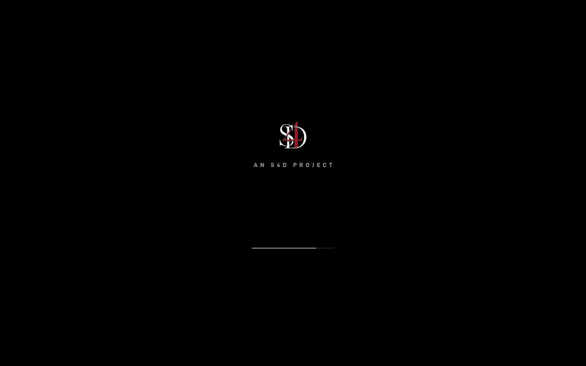
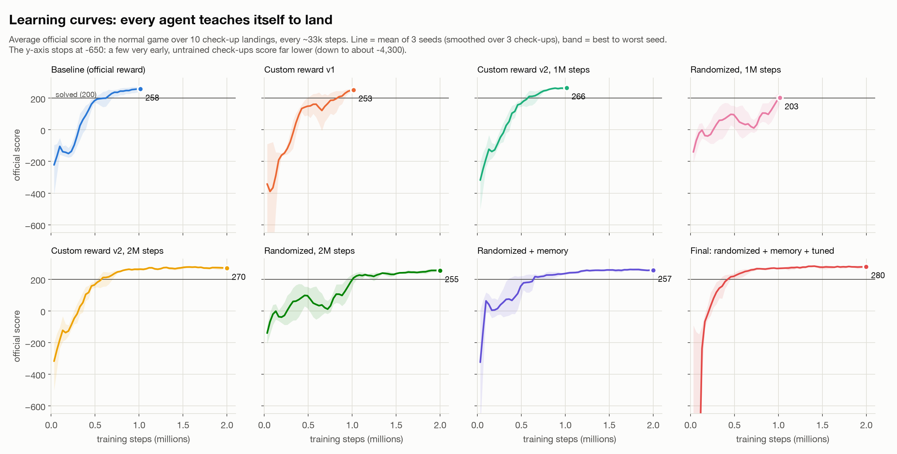
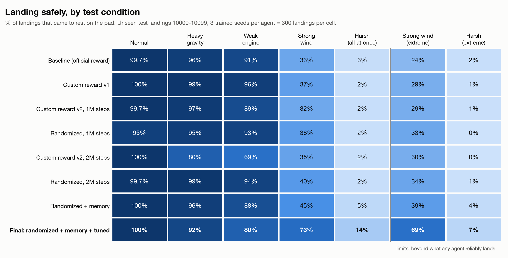
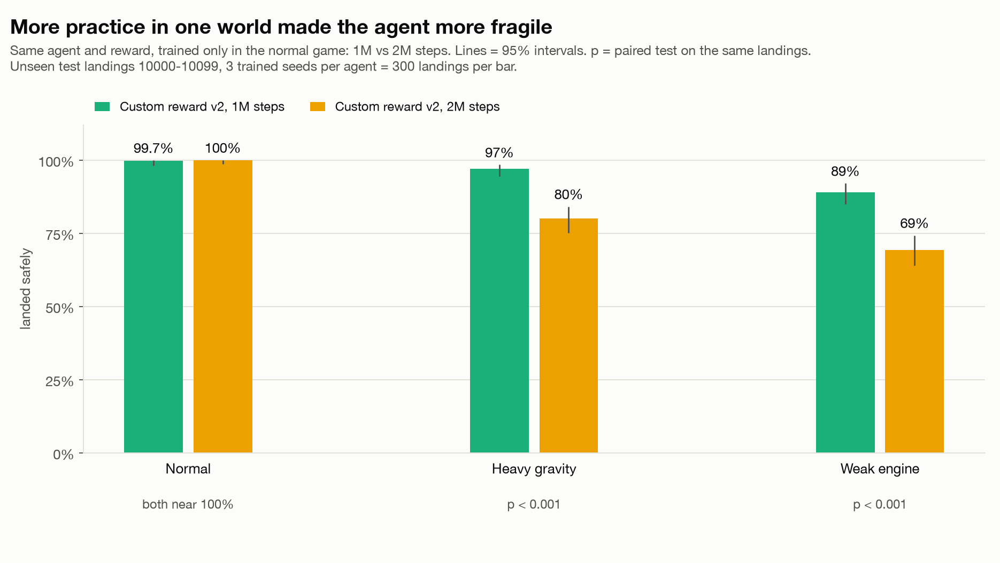
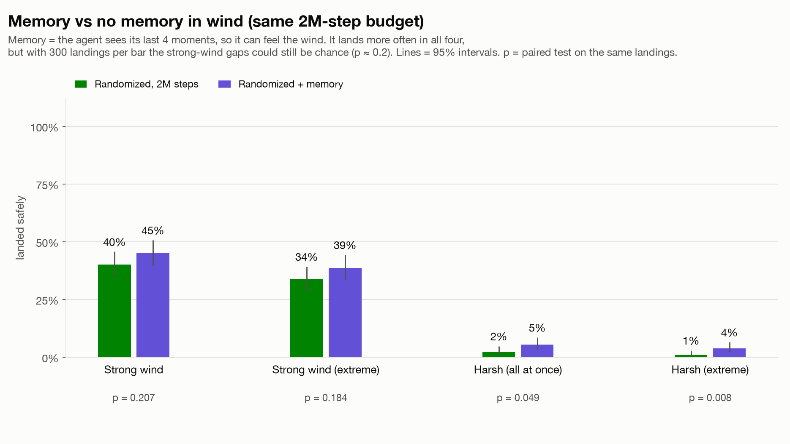

# LANDFALL

**A rocket-landing AI that taught itself to land by trial and error, trained in randomized gravity, wind, turbulence and engine power, the same "practise in a randomized simulation" idea robotics teams use.**

**Live demo:** https://s4dai-landfall.static.hf.space
**Video:** [same landing in gravity 12, normal-only AI vs the final AI](https://s4dai-landfall.static.hf.space/videos/side_by_side_heavy_gravity.mp4)



Set the gravity, wind, turbulence and engine power, pick a pilot, press Launch. Every landing is flown live in your browser by the trained neural network. The sliders go past the training range, so you can find where the AI breaks.

*Designed & built by Saad Hilal · S4D*

---

## Results at a glance

Tested **once**, on 100 landings no agent had ever seen, for each of 3 independently trained copies of every agent: **300 test landings per cell**. The test plan was committed to git before the test ran, and nothing was changed afterwards.

| | Baseline | Final AI |
|---|---|---|
| Lands safely, normal game | 99.7% | **100%** |
| Lands safely, **strong wind** (beyond training) | 33.3% | **73.0%** |
| Lands safely, harsh: wind + heavy gravity + weak engine | 2.7% | **13.7%** |
| Official score, normal game (200 = "solved") | 259.3 | **282.1** |
| Fuel per landing, normal game | 166 | **96** (42% less) |
| Time per landing, normal game | 6.5 s | **4.0 s** |
| Lands safely, heavy gravity (beyond training) | **96.0%** | 91.7% |
| Lands safely, weak engine (beyond training) | **91.0%** | 79.7% |

The last two rows matter: the final AI is **not** better everywhere. It is a fast, lean flyer, and that leaves less safety margin when gravity is stronger or the engine weaker than anything it practised with. More on that [below](#what-surprised-me).

---

## What it does

The simulator is [Gymnasium's LunarLander-v3](https://gymnasium.farama.org/environments/box2d/lunar_lander/): a small 2D rocket with a main engine and two side thrusters has to land between two flags. Every moment, the AI sees **8 numbers** (position, speed, tilt, spin, and whether each leg touches the ground) and presses **one of 4 buttons** (nothing, left thruster, main engine, right thruster), 50 times per simulated second.

Nobody tells it how to fly. It starts out pressing buttons at random and crashing, and teaches itself from points alone.

I trained 8 kinds of agent, one idea at a time, so each improvement can be measured on its own:

| Agent | What changed |
|---|---|
| Baseline | The game's own points only |
| Custom reward v1, v2 | My own reward rules on top (v2 = one round of fixes) |
| Randomized | Every practice flight rolls new gravity, wind, turbulence and engine power |
| Randomized + memory | Also sees its last 4 moments, so it can feel the wind |
| **Final AI** | Randomized + memory, with training settings found by automatic tuning |

---

## How it teaches itself (in plain words)

**Reinforcement learning is learning by trial and error, with points.** The game gives points for moving toward the pad, touching down gently and coming to rest, and takes points away for crashing and for burning fuel. The AI's only goal is to collect as many points as it can.

**The "brain" is a small neural network**: the 8 numbers go in, pass through two layers of 64 "neurons", and come out as a score for each of the 4 buttons. At first those scores are random.

**PPO** (Proximal Policy Optimization, the learning method) works in rounds:
1. 16 copies of the lander practise at the same time, 1,024 steps each (512 for the final AI).
2. For every button press, PPO asks: did things go better or worse than expected after this?
3. It nudges the network to press "better than expected" buttons more often, and "worse than expected" ones less often.
4. It never changes the network too much in one round (that's the "proximal" part), so learning stays stable.

Repeat, round after round. On a MacBook Air's CPU, the baseline's 1 million practice steps took **1.5 minutes**, and the final AI's 2 million took **under 6 minutes**. The learning curves show every agent going from crashing to scoring above 200, the official "solved" mark:



---

## Reward shaping: writing my own rules

The game's points work, but they don't say everything I care about. So I added my own rules on top (`reward_shaping.py`). **Every agent is still graded on the game's official score**, so the comparison stays fair.

| Rule | When | Points |
|---|---|---|
| Don't tilt | every step while flying | −1 × how far it leans |
| Don't hover | low over the ground but barely descending | −0.1 per step |
| Settle down | balancing on one leg, or firing engines with both legs down | −0.1 per step |
| Land softly | each touchdown faster than the safe speed | up to −30 |
| Settle fast | came to rest on the pad | up to +100, more the sooner it settles |
| Save fuel | came to rest on the pad | +0.5 per unit of fuel left unused |

Two of these needed fixing **before** any training, after I tested them with a random pilot:
- **The hard-landing penalty needed a cap.** Uncapped, a crash cost −259, which made the ground scarier than flying off the screen (−100). The AI could have learned never to land.
- **Tilt only counts while flying.** A lander parked crooked on a slope piled up −176, enough to make crashing on purpose look attractive.

### Version 1 → version 2: a rule that backfired

Version 1 fixed hovering, but it **burned more fuel** than the baseline (181 vs 166 per landing), the opposite of what its fuel bonus was for. I had set the "safe" touchdown speed at the baseline's typical speed, so most normal landings counted as too fast. The AI overcorrected: it touched down at **half the speed** and its final approach took **92 steps instead of 53**, burning fuel the whole way down.

**Lesson: reward rules compete with each other, and you find out how by measuring behaviour, not points.**

Version 2 (one tuning round: safe speed 0.20, fuel bonus doubled) fixed it. On 3,000 comparison landings (kept separate from the final test): fuel 136.5 per landing, landings in 5.6 s instead of 6.5 s, the best score (267.2 vs 257.1), and **0 crashes vs the baseline's 9**. To be honest about the fuel: v2 matches the baseline's two typical training runs (133–135); the baseline's average is pulled up by one wasteful run (230). So v2 is more **consistent**, not more efficient than the best baseline.

---

## The leg-sensor bug

After training the baseline, **7 of 100 check landings looked like hovering**: the flight ended with only one leg reading "touching the ground". I first reported this as the AI "balancing on one leg until time ran out". **That was wrong.**

Digging into the 7 flights showed that **6 had actually landed and come to rest**. Only the leg sensor disagreed. The cause is **a bug in the game**: the ground is made of separate straight segments, and when a leg slides from one segment onto the next, the game switches that leg's "touching" flag **off**, even though the leg is still on the ground. I confirmed it by asking the physics engine directly: every "missing" leg was physically touching the ground, right at a joint between two segments.

Only 1 of the 7 truly never settled, and the bug caused that too: it rested on both legs, but the faulty sensor told the AI one leg was up, so it kept firing a thruster to "fix" it until time ran out.

**The fix:** judge every landing, and my reward's leg rules, by asking the physics engine directly (`landing_stats.py`). The AI's own inputs are unchanged, so every agent still plays the same game. The real "never settles" rate was **0.4%** (11 of 3,000 landings), not 7%.

---

## Domain randomization: practising in a thousand worlds

An AI that only ever practises in one world learns tricks that only work there. So for the randomized agents, **every practice flight rolls new physics**:

| | Gravity | Wind | Turbulence | Engine power |
|---|---|---|---|---|
| Normal game | 10 | off | off | 100% |
| **Training range** | 8 – 11 | 0 – 15 | 0 – 1.5 | 85 – 115% |
| Test: heavy gravity | **12** | off | off | 100% |
| Test: weak engine | 10 | off | off | **80%** |
| Test: strong wind | 10 | **16.25** | **1.625** | 100% |
| Test: harsh | **11.25** | **16.25** | **1.625** | **84%** |

**Every test value is outside the training range**: the AI is always tested in conditions it never practised in.

It didn't work the first time. With the normal training budget, the randomized agent was **worse** than the baseline in the normal game (92.9% vs 99.1%). The cause was under-training: practising in many worlds takes longer. With the same 2-million-step budget as the others, it caught up in the normal game and became far more robust (see the test results below).

**Memory.** Wind is invisible: from a single moment, the AI can't tell a gust from its own drift. So the final agent sees its **last 4 moments**, which is enough to feel which way it's being pushed. That helped in wind, and cost a little elsewhere.

**Is the test even landable?** My first wind tests were so strong that a specialist trained only in that wind landed just 10.6% of the time. I'd written a rule **before** looking at any results: if a specialist can't land at least half the time, soften the test halfway back toward the training range. The first softening still failed (25.4%), so I softened once more for the main tests. The two stronger versions stay in the results as "extreme" rows, to show where the AI breaks.

---

## Auto-tuning with Optuna

[Optuna](https://optuna.org) searched for better training settings (learning rate, round length, how many passes over each round, and so on) for the final agent: **28 trials in about 48 minutes**, with unpromising trials stopped early.

The honesty rule: tuning could only use the **training conditions** and a separate set of **validation landings**. It never saw the harsh test conditions or the final test landings, so the final test is a fair surprise.

The winner scored **261.0 vs 227.0** on validation, and won on all 3 training seeds, including 2 seeds the search never used. Biggest changes: 9 learning passes per round instead of 4, shorter rounds, and smaller, safer policy updates.

---

## Final results

Run **exactly once**: `final_eval.py` was committed (`d144efa`) before it ran, and it refuses to run a second time. (`runs/final/results.json` records that commit as `6ca403d`, its ID before the commit author details were updated.) 8 agents × 3 trained copies × 7 conditions × 100 unseen landings = **16,800 test landings**.

**Success rate, average official score and fuel per landing** (300 landings per cell):

| Agent | Normal: landed | Normal: score | Normal: fuel | Strong wind: landed | Strong wind: score | Strong wind: fuel | Harsh: landed | Harsh: score |
|---|---|---|---|---|---|---|---|---|
| Baseline (official reward) | 99.7% | 259.3 | 166 | 33.3% | 104.3 | 155 | 2.7% | −125.6 |
| Custom reward v1 | 100% | 256.5 | 181 | 37.3% | 114.1 | 167 | 1.7% | −99.9 |
| Custom reward v2, 1M steps | 99.7% | 268.9 | 137 | 32.3% | 114.6 | 134 | 2.3% | −129.3 |
| Randomized, 1M steps | 94.7% | 229.2 | 248 | 38.3% | 114.1 | 221 | 1.7% | −78.7 |
| Custom reward v2, 2M steps | 100% | 278.3 | 110 | 35.3% | 116.5 | 107 | 1.7% | −91.2 |
| Randomized, 2M steps | 99.7% | 258.6 | 172 | 40.0% | 133.7 | 162 | 2.3% | −82.1 |
| Randomized + memory | 100% | 260.5 | 170 | 45.0% | 146.2 | 159 | 5.3% | −43.3 |
| **Final: randomized + memory + tuned** | **100%** | **282.1** | **96** | **73.0%** | **205.7** | **110** | **13.7%** | **−4.0** |

Fuel is per safe landing (main engine = 1 unit per step, side thruster = 0.1). It's left out for harsh, where most agents land too rarely to average.

Every condition, as a heatmap:



Differences were checked with **paired tests** on the same landings (`runs/final/results.md`). Final AI vs baseline: strong wind 73.0% vs 33.3%, harsh 13.7% vs 2.7%, extreme wind 69.0% vs 24.0% (all p < 0.001).

---

## What surprised me

**1. More practice in one world made the AI more fragile.** The same agent, trained in the normal game for 1 million and then 2 million steps: in the normal game nothing changed, but under heavy gravity its success **dropped from 97.0% to 80.0%**, and with a weak engine **from 89.0% to 69.3%**. With more practice it learned to brake at the very last moment with exactly the thrust normal gravity needs, and no margin. Randomized practice with the same budget held 99.0% and 93.7%. That is the textbook case for domain randomization.



**2. Efficiency vs safety margin.** The final AI lands in 4.0 s on 96 fuel, so it spends less time being pushed around by wind. But with a weak engine it crashed 19.7% of the time, vs 5.7% for the slower randomized agent (6.6 s, 172 fuel). Tuning optimised the official score, which rewards saving fuel, so it found a lean flyer. This explanation fits the data, but I haven't proven it. On the website, "Careful" (randomized, 2M steps) is the pilot to pick for heavy gravity or a weak engine; the Final AI is the one for wind.

**3. Memory is a trade-off, not a free win.** Compared with the same agent without memory, it helped in the harsh conditions (5.3% vs 2.3%, p = 0.049; extreme harsh 3.7% vs 1.0%, p = 0.008) and by 5 points in strong wind: significant on 1,500 earlier comparison landings, but not on the 300 test landings. It cost a few points under heavy gravity (95.7% vs 99.0%) and with a weak engine (87.7% vs 93.7%).



**4. Specialists underestimate what's landable.** An agent trained only in the "extreme" wind landed 25.4% there; the general agent with memory, which learned to land first and handle wind second, landed 40.6% in the same wind. Learning to land in a gale from scratch is harder than learning to land first. That's an argument for curriculum learning.

---

## The website

LANDFALL (`web/`) is hand-written HTML, CSS and JavaScript in a mission-control style: a webcast telemetry bar, a T−3 countdown, live wind, glass panels, and a result card (TOUCHDOWN CONFIRMED or VEHICLE LOST) with flight time, fuel used and landing speed.

- **Sliders with zones:** green = the AI trained here, amber = beyond training, red = physically impossible (for example, engine weaker than gravity). The red limits come from engine power and gravity **measured in the simulator**.
- **"Landing possible?" check** and an **expected landing rate** for the current settings, taken from the nearest real test result.
- **Compare mode:** two pilots fly the exact same landing side by side.
- **Flies in your browser.** Free Hugging Face hosting only serves files, so I rewrote the game's physics in JavaScript (on [planck.js](https://piqnt.com/planck.js/), a JavaScript version of the physics engine the Python game uses). I also ported NumPy's random-number generator bit for bit, so every landing has the same terrain and gusts as in Python, and exported the trained networks. Checked against the Python simulator on 1,500 official test landings (`check_browser_sim.py`): **the same outcome on 99.2%**, landing rates within 0.6 points on average.
- Works on phones, uses lighter effects on slower devices, and respects "reduce motion".

---

## Videos

Real test landings, redrawn sharply at 1920×1280 from the recorded physics (`make_videos.py`). Each one is checked to match the evaluation's outcome and score exactly.

| Clip | What it shows |
|---|---|
| [untrained_crash.mp4](videos/untrained_crash.mp4) | The untrained network on its first test landing |
| [baseline_landing.mp4](videos/baseline_landing.mp4) | The baseline in the normal game |
| [final_strong_wind_arrow.mp4](videos/final_strong_wind_arrow.mp4) | The final AI in strong wind, with a live wind arrow |
| [side_by_side_heavy_gravity.mp4](videos/side_by_side_heavy_gravity.mp4) | Gravity 12, the same landing: trained in the normal game only (crashes) vs the final AI (lands). One example; across all 300 landings the rates are 80% and 92% |

---

## How to run it

On a Mac (Apple Silicon or Intel):

```bash
brew install python@3.11 swig ffmpeg
python3.11 -m venv .venv
.venv/bin/pip install -r requirements.txt
.venv/bin/python check_setup.py          # proves the simulator works
```

| Command | What it does |
|---|---|
| `.venv/bin/python app.py` | The website, at http://127.0.0.1:7860 |
| `.venv/bin/python train.py --agent baseline` | Train one agent type (3 seeds; a few minutes each) |
| `.venv/bin/tensorboard --logdir runs/tensorboard` | Watch training live, at http://localhost:6006 |
| `.venv/bin/python evaluate.py models/randomized_memory_tuned_seed42.zip --episodes 100` | Fly a trained model 100 times and report the results |
| `.venv/bin/python compare.py --agents baseline shaped_v2` | Compare agents on the same landings, with a significance test |
| `.venv/bin/python tune.py search` | The Optuna search (about 50 minutes) |
| `.venv/bin/python make_charts.py` | Redraw the charts from the saved results |
| `.venv/bin/python make_videos.py` | Re-render the videos |
| `.venv/bin/python check_browser_sim.py` | Browser physics vs Python on 1,500 test landings (needs Node.js) |
| `.venv/bin/python make_space.py --push USER/landfall` | Upload the website to a free Hugging Face Space |

Agent types: `baseline`, `shaped_v1`, `shaped_v2`, `randomized`, `shaped_v2_2m`, `randomized_2m`, `randomized_memory`, `randomized_memory_tuned`. Training is bit-for-bit reproducible on the same computer: the same seed gives the same model.

## Project layout

| File | What it does |
|---|---|
| `config.py` | Every shared setting: PPO settings, seeds, training budget, randomization ranges, test conditions |
| `envs.py` | Builds each agent's practice world; `AGENTS` lists the only differences between agent types |
| `reward_shaping.py` | My reward rules (v1 and v2) |
| `domain_randomization.py` | Sets gravity, wind, turbulence and engine power, fixed or re-rolled every flight |
| `landing_stats.py` | Judges each landing by asking the physics engine (the leg-sensor bug fix) |
| `train.py`, `evaluate.py`, `compare.py` | Train, test and compare agents |
| `tune.py` | Optuna auto-tuning |
| `final_eval.py` | The one-time final test (refuses to run twice) |
| `make_charts.py`, `make_videos.py`, `render.py` | Charts and videos |
| `app.py`, `web/` | The website (`web/sim/` = the game and the pilots in JavaScript) |
| `export_site_data.py`, `export_browser_pilots.py` | Data and trained networks for the website |
| `models/` | All trained models (3 seeds per agent, ~150 KB each) |
| `runs/` | Training logs, learning curves, TensorBoard logs, every test landing (`runs/final/episodes.csv`) |
| `PROGRESS.md` | The full build log, step by step, with every decision |

## Credits

Simulator: [Gymnasium](https://gymnasium.farama.org) LunarLander-v3 (Box2D). Learning: [Stable-Baselines3](https://stable-baselines3.readthedocs.io) PPO, starting from the [RL Baselines3 Zoo](https://github.com/DLR-RM/rl-baselines3-zoo) LunarLander settings. Tuning: [Optuna](https://optuna.org). Browser physics: [planck.js](https://github.com/piqnt/planck.js) (MIT). Typeface: D-DIN by Datto (SIL Open Font License, `web/fonts/OFL.txt`).

*Designed & built by Saad Hilal · S4D*
